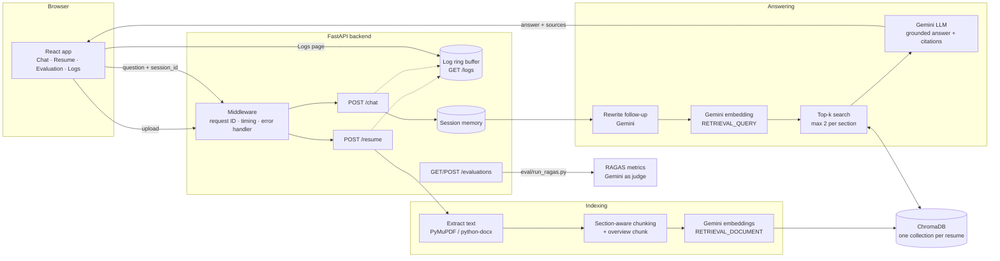

# Resume Chatbot — AI-Powered Q&A over a Resume using RAG

[](https://github.com/shivamugale4533-dev/resume-rag-chatbot/actions/workflows/ci.yml)

A chatbot that answers questions about a candidate's resume using **Retrieval-Augmented Generation (RAG)**.
Upload a PDF or DOCX resume, then ask questions such as *"Which vector databases does the candidate know?"*
and follow-ups such as *"Which of those were used in projects?"*. Every answer cites the resume excerpts it used.

| | |
|---|---|
| **Live application** | https://resume-rag-chatbot-umber.vercel.app |
| **Backend API** | https://resume-chatbot-api-gtw0.onrender.com ([interactive docs](https://resume-chatbot-api-gtw0.onrender.com/docs)) |
| **Repository** | https://github.com/shivamugale4533-dev/resume-rag-chatbot |
| **RAGAS report** | [docs/RAGAS_REPORT.md](docs/RAGAS_REPORT.md) |

> **Note on the free hosting tier:** the backend sleeps after 15 minutes without traffic, so the first request may take about one minute. Its disk is temporary, so after a restart please upload the resume again on the **Resume** page.

---

## Features and assignment requirements

| # | Requirement | Implementation |
|---|---|---|
| 1 | Responsive React chat interface | React 18 + TypeScript + Vite; Chat, Resume, Evaluation and Logs pages; mobile drawer layout |
| 2 | REST APIs with FastAPI | `backend/app/main.py`; Pydantic validation; OpenAPI docs at `/docs` |
| 3 | RAG architecture | Extract (PyMuPDF / python-docx) → section-aware chunking → Gemini embeddings → ChromaDB → top-k retrieval → Gemini answer with citations |
| 4 | Follow-up questions | LLM query rewriting turns follow-ups into standalone search questions |
| 5 | Session memory | Server-side memory per `session_id` (last 20 messages) with the client history as fallback |
| 6 | Upload / replace CV | `POST /resume`; the new resume is indexed in a new collection before the old one is removed (no downtime) |
| 7 | Chat history and logs | Conversations kept per browser session; structured logs of requests, errors, uploads, retrieval and LLM calls at `GET /logs` and on the Logs page |
| 8 | RAGAS evaluation | 18-case dataset; Faithfulness, Answer Relevancy, Context Precision, Context Recall, Answer Correctness |
| 9 | Benchmark report | [docs/RAGAS_REPORT.md](docs/RAGAS_REPORT.md) and the Evaluation page |
| 10 | Docker | `backend/Dockerfile`, `frontend/Dockerfile` (multi-stage, nginx), `docker-compose.yml` |
| 11 | CI/CD | GitHub Actions: pytest, frontend tests and build, Docker image builds; Render deploys after checks pass, Vercel deploys on push |
| 12 | Deployment | Backend on Render (Docker), frontend on Vercel |

---

## Architecture



### Repository layout

```
resume_project/
├── backend/
│   ├── app/
│   │   ├── main.py          # FastAPI app, endpoints, middleware
│   │   ├── extract.py       # PDF/DOCX text extraction
│   │   ├── chunking.py      # section-aware chunking + overview chunk
│   │   ├── embeddings.py    # Gemini embeddings + retry with backoff
│   │   ├── vector_store.py  # ChromaDB storage and search
│   │   ├── rag.py           # prompts, answer generation, query rewriting
│   │   ├── memory.py        # per-session conversation memory
│   │   ├── logs.py          # structured in-memory logs
│   │   ├── evaluation.py    # evaluation runs (list / read / start)
│   │   └── config.py        # settings from environment variables
│   ├── eval/                # RAGAS dataset, runner and saved results
│   ├── tests/               # pytest suite (Gemini mocked)
│   └── Dockerfile
├── frontend/                # React + TypeScript + Vite app, Dockerfile, nginx.conf
├── docs/                    # RAGAS report, deployment guide, learning notes
├── docker-compose.yml
├── render.yaml              # Render Blueprint (backend)
└── .github/workflows/ci.yml # CI/CD pipeline
```

---

## Technology stack

| Layer | Choice | Reason | Alternatives considered |
|---|---|---|---|
| Frontend | React 18, TypeScript, Vite | Required by the assignment; type safety; fast builds | Next.js, Vue |
| Backend | FastAPI, Pydantic, Uvicorn | Automatic request validation and API docs; simple, fast | Flask, Django REST Framework |
| RAG orchestration | Plain Python | Every step is explicit and easy to debug and explain; fewer dependencies | LangChain, LlamaIndex, Haystack |
| LLM | Gemini Flash-Lite (configurable) | Low latency, free tier, one provider for LLM and embeddings | OpenAI GPT, Claude, local Llama via Ollama |
| Embeddings | `gemini-embedding-001`, 768 dimensions | Task-specific embeddings (document vs. query); smaller vectors are faster | OpenAI `text-embedding-3`, Sentence Transformers |
| Vector database | ChromaDB (persistent, cosine) | Embedded in the app, no separate server, persists to disk | FAISS, Qdrant, Pinecone, pgvector |
| Extraction | PyMuPDF, python-docx | Accurate text with page numbers; DOCX tables supported | pdfplumber, pypdf, Unstructured |
| Evaluation | RAGAS 0.4 (Gemini as judge) | Standard RAG metrics covering retrieval and generation | DeepEval, TruLens, LangSmith |
| Testing | pytest, Vitest | Fixtures and mocking; fast and offline | unittest, Jest |
| Containers | Docker, Docker Compose | Reproducible environment; one-command start | Podman |
| CI/CD | GitHub Actions, Render, Vercel | Free for public repositories; Git-based deploys | GitLab CI, Jenkins, Railway, Netlify |

---

## How the RAG pipeline works

**Indexing (on upload)**
1. **Validation:** extension (`pdf`, `docx`), empty file, size limit, readable text.
2. **Extraction:** PyMuPDF reads each PDF page (page numbers are kept for citations); python-docx reads paragraphs and tables.
3. **Chunking:** headings such as *Skills*, *Experience* or *Projects* start a new section; every project becomes its own section (`Projects > <title>`); text longer than 500 characters is split at word boundaries with a 100-character overlap; the section name is prefixed to each chunk so short chunks keep their meaning. An extra **overview chunk** lists all sections and project names, which answers list questions such as *"What projects are listed?"*.
4. **Embedding:** all chunks are embedded in one batched Gemini request (`RETRIEVAL_DOCUMENT`).
5. **Storage:** chunks, vectors and metadata (section, page) go into a new ChromaDB collection. Only after it is complete does the app switch to it and delete the previous resume's collection.

**Answering (on each question)**
1. **Memory:** the last messages of the session are loaded.
2. **Query rewriting:** if there is history, Gemini rewrites the question into a standalone one (temperature 0). If this fails, the original question is used.
3. **Retrieval:** the question is embedded (`RETRIEVAL_QUERY`) and the 4 most similar chunks are returned, with at most 2 from the same section for diversity.
4. **Generation:** Gemini answers using only the numbered excerpts, cites them as `[n]`, says *"I couldn't find that information in the resume."* when the answer is missing, and treats excerpts as data, not instructions (prompt-injection defence). Temperature 0.2.
5. The turn is saved to memory; the response includes the answer and the cited sources (text, section, page, score).

---

## Follow-up questions and memory

- The frontend creates a `session_id` per conversation and sends it with the recent history.
- The backend keeps up to 20 messages per session in memory. After a server restart it falls back to the history sent by the client, so conversations continue to work.
- Follow-ups are resolved by **query rewriting** before retrieval (for example *"Which of those were used in projects?"* → *"Which programming languages from the candidate's skills were used in projects?"*). The rewritten question is visible in the `query.rewritten` and `retrieval.executed` log events.
- Deleting a conversation calls `DELETE /chat/sessions/{session_id}`, which removes its memory.

---

## API

| Method | Path | Description |
|---|---|---|
| GET | `/health` | Liveness check |
| GET | `/config` | Accepted file types and maximum upload size |
| POST | `/resume` | Upload or replace the resume (`multipart/form-data`, field `file`) |
| GET | `/resume` | Active resume metadata |
| GET | `/resume/{id}/status` | Status of an upload |
| GET | `/resume/chunks` | Chunks of the active resume (debugging) |
| GET | `/search?q=` | Retrieval only, with scores (debugging) |
| POST | `/chat` | `{session_id, question, history}` → `{answer, sources, needs_clarification}` |
| DELETE | `/chat/sessions/{id}` | Forget a conversation's memory |
| GET | `/logs` | Logs with `level`, `event`, `q`, `cursor`, `limit` filters |
| GET | `/evaluations` | List of RAGAS runs |
| GET | `/evaluations/{id}` | One run with per-case results |
| POST | `/evaluations` | Start a run (local only; returns 501 where RAGAS is not installed) |

The full request/response contract is in [frontend/API_CONTRACT.md](frontend/API_CONTRACT.md).

### Error handling

| Status | When | Example message |
|---|---|---|
| 400 | Empty file; chat or evaluation without a resume | "Please upload a resume first." |
| 404 | Unknown resume, run or no resume yet | "No resume uploaded yet." |
| 409 | An evaluation is already running | "An evaluation is already running…" |
| 413 | File larger than `MAX_UPLOAD_MB` | "File is larger than 10 MB." |
| 415 | Not a PDF or DOCX | "Only PDF and DOCX files are supported." |
| 422 | Corrupted file, scanned PDF without text, invalid request body | "No text found. The file may be a scanned image…" |
| 500 | Unexpected error (logged with its request ID) | "Internal server error. Please try again." |
| 501 | Evaluation started on a server without RAGAS | "RAGAS is not installed on this server…" |
| 503 | Gemini unavailable or rate limited (after retries with backoff) | "AI service failed: …" |

Every response carries an `X-Request-ID` header that matches the log entries of that request.

---

## Running locally

**Prerequisites:** Python 3.12, Node.js 20+ (22 recommended), a Gemini API key from [Google AI Studio](https://aistudio.google.com/apikey).

### Backend
```bash
cd backend
uv venv --python 3.12 && source .venv/bin/activate     # or: python3.12 -m venv .venv
uv pip install -r requirements-dev.txt                 # or: pip install -r requirements-dev.txt
cp .env.example .env                                   # then set GEMINI_API_KEY
uvicorn app.main:app --reload                          # http://localhost:8000/docs
```

### Frontend
```bash
cd frontend
npm ci
npm run dev                # http://localhost:5173, uses VITE_API_BASE_URL (default http://localhost:8000)
npm run dev:demo           # optional: bundled sample data, no backend needed
```

### Configuration
All backend settings are environment variables (see [backend/.env.example](backend/.env.example)):
`GEMINI_API_KEY`, `FRONTEND_ORIGINS`, `CHAT_MODEL`, `EMBEDDING_MODEL`, `EMBEDDING_DIM`, `TOP_K`,
`MAX_CHUNKS_PER_SECTION`, `MAX_HISTORY_MESSAGES`, `MAX_UPLOAD_MB`, `CHROMA_DIR`, `EVAL_LLM_MODEL`, `EVAL_EMBEDDING_MODEL`.
Model names are configurable because Google renames and retires models over time.

---

## Running with Docker

```bash
cp backend/.env.example backend/.env      # set GEMINI_API_KEY
docker compose up --build
```
- Frontend: http://localhost:8080
- Backend: http://localhost:8000 (API docs at `/docs`)

The backend runs as a non-root user with a health check; ChromaDB data is kept in the `backend_data` volume.
The frontend image is a multi-stage build (Node build → nginx) with an SPA fallback.
To build the frontend for another API address: `docker build --build-arg VITE_API_BASE_URL=https://api.example.com ./frontend`.

---

## Tests

```bash
cd backend && pytest -v        # 43 tests: chunking, API, upload validation, chat, memory, logs, evaluations
cd frontend && npm test        # 12 tests: HTTP adapter, markdown rendering, chat flow, composer
```
The backend tests replace the Gemini client with a deterministic fake and block all network access, so they run offline in about one second and need no API key.

---

## RAGAS evaluation

```bash
cd backend
uv pip install -r requirements-eval.txt
python -m eval.run_ragas            # all 18 cases (about 25 minutes on the free tier)
python -m eval.run_ragas --limit 3  # quick check
```
Results are written to `backend/eval/results/<run_id>.json` and appear on the **Evaluation** page.
RAGAS is intentionally not installed in the production image; the deployed app shows the committed results.

See **[docs/RAGAS_REPORT.md](docs/RAGAS_REPORT.md)** for the setup, scores, per-case results, interpretation and the improvements made between runs.

---

## CI/CD

`.github/workflows/ci.yml` runs on every push and pull request to `main`:
1. **Backend:** install dependencies and run pytest (no secrets required).
2. **Frontend:** `npm ci`, `npm test`, `npm run build`.
3. **Docker:** build both images and start the backend container to check `/health`.
4. **Deploy (optional):** call a Render deploy hook if the `RENDER_DEPLOY_HOOK_URL` secret is set.

Continuous deployment: Render redeploys the backend only after the checks pass (`autoDeployTrigger: checksPass` in `render.yaml`); Vercel redeploys the frontend on every push to `main`.

---

## Deployment

Step-by-step instructions are in **[docs/DEPLOYMENT.md](docs/DEPLOYMENT.md)**.
In short: the Render Blueprint (`render.yaml`) creates the Docker web service (only `GEMINI_API_KEY` is entered manually),
Vercel builds the `frontend/` directory with `VITE_API_BASE_URL` pointing to the Render URL, and `FRONTEND_ORIGINS` on the backend allows the Vercel domain.

---

## Limitations and future improvements

| Area | Current state | Improvement |
|---|---|---|
| Memory and logs | In process memory, single instance | Redis for sessions; central logging (Loki, ELK, Cloud Logging) |
| Storage | Free-tier ephemeral disk | Persistent disk or managed vector DB (Qdrant Cloud, pgvector) plus object storage |
| Scanned PDFs | Rejected with a clear message | OCR (Tesseract or a vision model) for image-only pages |
| Retrieval | Dense vector search, top 4, section diversity | Hybrid search (BM25 + vectors), cross-encoder reranking |
| Answers | Returned when complete | Streaming responses (Server-Sent Events) |
| Users | Single shared resume, no login | Authentication (OAuth/JWT) and per-user resumes |
| Evaluation | 18 hand-checked cases, LLM judge | Larger dataset, scheduled evaluation in CI, human review |
| Resilience | Retries with backoff | Fallback LLM provider, circuit breaker, per-user rate limits |
